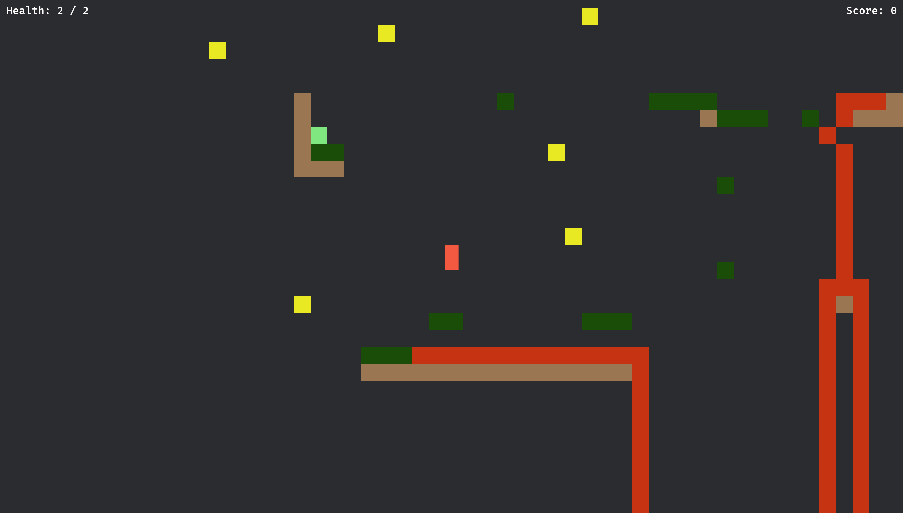
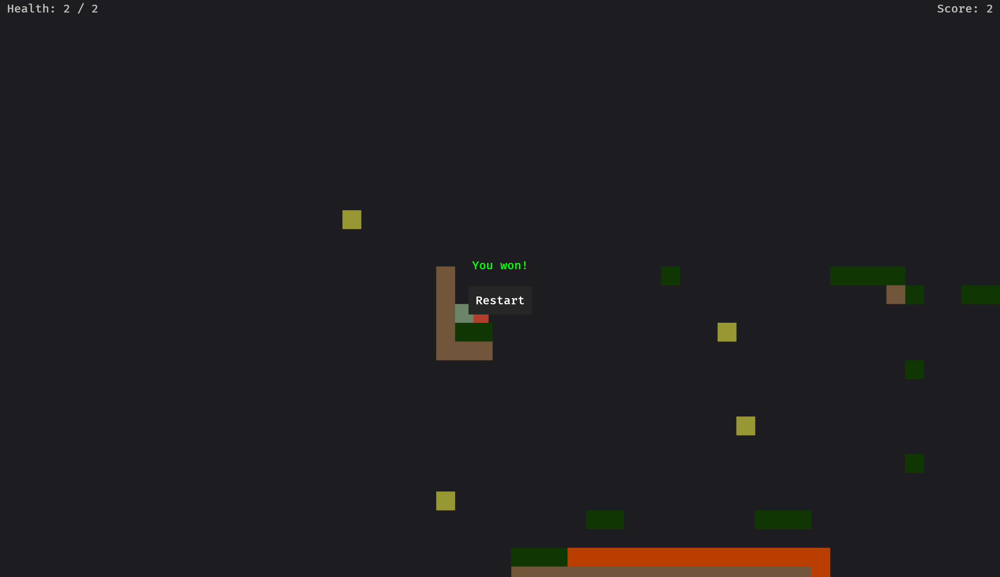
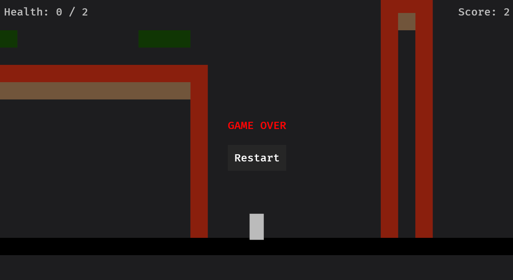

# Platformer Game
A simple platformer game made in Rust with the Bevy game engine.

The point of the game is to reach the "Win" tile, while collecting as many coins along the way to increase your score as you can.
There are many gaps and a lot of lava so there are many opportunities for the user to die. The player has 2 health so users may be able to survive accidentally falling into lava if they can exit quick enough.

## Controls
Use the 'a' or the left arrow key to move left and 'd' or the right arrow key to move right. You can jump up to two times before touching the ground by pressing 'space' or the up arrow key.

## The Game
There are 6 types of tiles
Dirt - Solid brown tile
Grass - Solid green tile
Lava - Animated red tile that takes away one health from the player and slows them down
Bedrock - Black tile located at the bottom of the world that kills the player on contact with it
Coin - Animated yellow tile that increases the player's score when obtained (it can be obtained by touching it)
Win - A special animated tile that cycles between Green, White, and Magenta. Contact this tile to win the game.

The player's health is displayed in the top-left of the screen and the score (number of coins collected) is displayed in the top-right.

## Pictures
Full level screenshot

Win Screen

Death Screen
